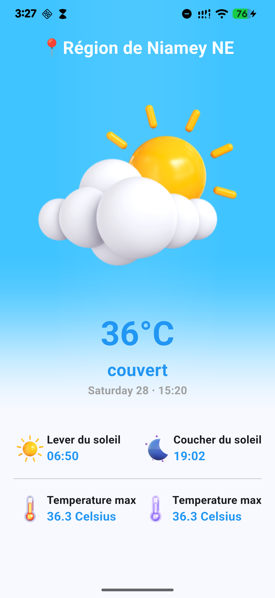

# Météo

**Application météo Flutter avec géolocalisation — MVVM (BLoC comme ViewModel) + get_it**

[Live demo](https://meteo-brown-psi.vercel.app/)

[](https://github.com/Idjibo33/meteo/actions/workflows/flutter.yml)



## Fonctionnalités

- **Géolocalisation :** récupération de la position actuelle de l'utilisateur (`geolocator`).
- **Météo actuelle :** conditions, température et détails via l'API **OpenWeatherMap** (package `weather`).
- **Conditions illustrées :** mapping des conditions météo vers des icônes dédiées.
- **Données fraîches :** rafraîchissement toutes les 10 min quand l'app est active, et au retour
  au premier plan si l'observation est périmée. L'écran affiche « À jour », l'âge de l'observation
  ou « Données périmées » ; le bouton « Actualiser » permet de forcer un appel immédiat.
- **Chargement explicite :** un aperçu de la page se construit pendant l'attente, avec une ligne
  indiquant l'étape en cours (« Recherche de votre position… », puis « Récupération de la météo… »)
  et une barre fine sans pourcentage. Les animations sont désactivées si le téléphone le demande.
- **Pull-to-refresh :** tirer la page vers le bas pour actualiser, avec la même ligne d'étape.
  Le geste réutilise la position connue, sans nouvelle géolocalisation ni appel en double.
- **Interface responsive :** adaptation aux différentes tailles d'écran.

## Stack technique

| Domaine | Technologie |
|---|---|
| Framework | Flutter / Dart |
| Gestion d'état | MVVM : BLoC (`flutter_bloc`, `bloc`) comme ViewModel |
| Injection de dépendances | `get_it` |
| Données | `weather` (OpenWeatherMap), `geolocator` |
| Utilitaires | `equatable`, `intl`, `gap` |

## Architecture

```
lib/
├── main.dart                     # Point d'entrée : DI, formatage fr_FR, BlocProvider
├── constants.dart                # Couleurs
├── Helpers/                      # Transverses : get_it, formatage, responsive, conditions météo
├── model/                        # Données et règles métier
│   ├── failures.dart             # Raisons d'échec typées et geste de reprise associé
│   └── services/                 # weather_service (API), geolocator_service
├── view/                         # Présentation
│   ├── screens/                  # Écran principal
│   └── widgets/                  # Fond, propriétés, aperçu de chargement
└── viewmodel/                    # WeatherBloc, événements, états (machine unique)
```

La `view` n'accède jamais directement aux services : elle pilote le ViewModel via
`BlocProvider` / `BlocBuilder`, qui expose les états `WeatherLocating`, `WeatherLoading`,
`WeatherSuccess` et `WeatherFailure`.

## Design

Palette volontairement limitée à trois teintes définies dans `lib/constants.dart` :
fond noir, texte blanc (dont les variantes ne sont que des opacités) et teal `#26A69A`
comme seul accent. Aucun dégradé, aucune ombre décorative et aucun émoji utilisé comme
icône : la hiérarchie repose sur la typographie (température en très gros chiffres,
min/max et horaires dans un grille sobre) et sur l'accent teal réservé aux signaux
actionnables. Le bouton « Actualiser » réutilise l'état courant sans repositionner.
Pendant le chargement, l'aperçu reste neutre (aucune valeur inventée) : seul le bloc de
température et la fine barre d'étape portent le teal.

## Installation

Prérequis : une clé API [OpenWeatherMap](https://openweathermap.org/api) (gratuite pour un usage standard).

```bash
flutter pub get

# La clé n'est pas stockée dans le dépôt : elle est fournie au build
flutter run --dart-define=OPENWEATHER_API_KEY=<votre_clé>

# Ou, pour un usage local, via un .env gitignoré :
# OPENWEATHER_API_KEY=<votre_clé>
flutter run --dart-define-from-file=.env -d <id-appareil>

# Build web / déploiement : passer le même argument
flutter build web --release --dart-define=OPENWEATHER_API_KEY=<votre_clé>
```

> Sans clé valide, l'appel API échoue et l'écran d'erreur s'affiche.

## Branches et environnements

| Branche | Rôle |
|---|---|
| `main` | Production — déployée automatiquement par Vercel |
| `develop` | Développement — cible des branches de travail et de la CI |

Les branches `feat/...`, `fix/...` et `chore/...` partent de `develop` et y reviennent via PR.
La promotion `develop` → `main` se fait seulement après validation explicite. La CI
(`.github/workflows/flutter.yml`) couvre les deux branches.

## Limites et prochaines étapes

- Prévisions sur plusieurs jours.
- Épingler une version de Flutter dans la CI (le canal `stable` non figé peut faire apparaître des avertissements de dépréciation).

## Licence

[MIT](LICENSE)
