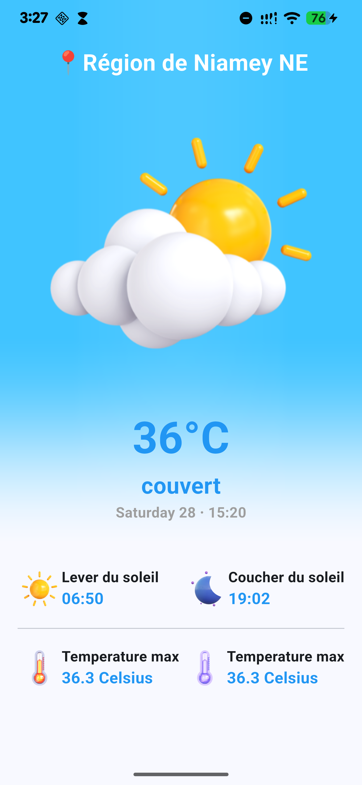

# Météo

**Application météo Flutter avec géolocalisation — BLoC + get_it**

[Live demo](https://meteo-brown-psi.vercel.app/)

[](https://github.com/Idjibo33/meteo/actions/workflows/flutter.yml)



## Fonctionnalités

- **Géolocalisation :** récupération de la position actuelle de l'utilisateur (`geolocator`).
- **Météo actuelle :** conditions, température et détails via l'API **OpenWeatherMap** (package `weather`).
- **Conditions illustrées :** mapping des conditions météo vers des icônes dédiées.
- **Interface responsive :** adaptation aux différentes tailles d'écran.

## Stack technique

| Domaine | Technologie |
|---|---|
| Framework | Flutter / Dart |
| Gestion d'état | BLoC (`flutter_bloc`, `bloc`) |
| Injection de dépendances | `get_it` |
| Données | `weather` (OpenWeatherMap), `geolocator` |
| Utilitaires | `equatable`, `intl`, `gap` |

## Architecture

```
lib/
├── main.dart                     # Point d'entrée (FutureBuilder position + BlocProvider)
├── constants.dart                # Couleurs
├── Helpers/                      # get_it, formatage de date, conditions météo, responsive
└── Weather/
    ├── bloc/                     # WeatherBloc, événements, états
    ├── Screens/                  # Écran principal
    ├── Services/                 # weather_service (API), geolocator_service
    └── Widgets/                  # Fond, propriétés
```

## Installation

Prérequis : une clé API [OpenWeatherMap](https://openweathermap.org/api) (gratuite pour un usage standard).

```bash
flutter pub get

# La clé n'est pas stockée dans le dépôt : elle est fournie au build
flutter run --dart-define=OPENWEATHER_API_KEY=<votre_clé>

# Build web / déploiement : passer le même argument
flutter build web --dart-define=OPENWEATHER_API_KEY=<votre_clé>
```

> Sans clé valide, l'appel API échoue et l'écran d'erreur s'affiche.

## Limites et prochaines étapes

- Prévisions sur plusieurs jours.
- Tests unitaires du `WeatherBloc` (mock du service météo).
- Message d'erreur explicite lorsque la clé API est absente du build.

## Licence

[MIT](LICENSE)
